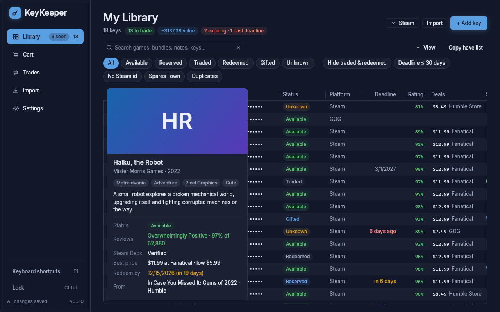
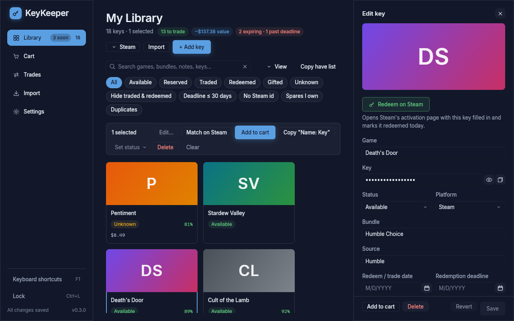
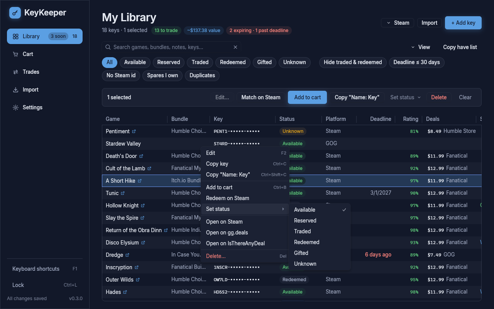
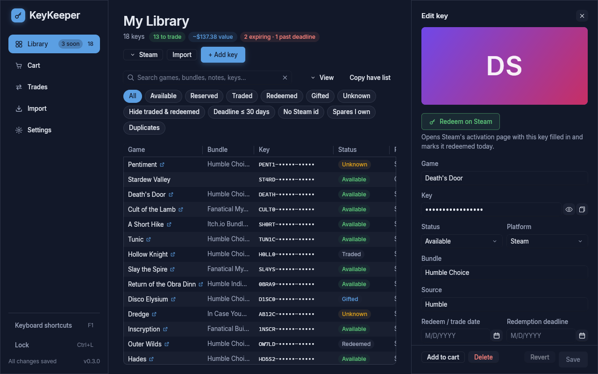
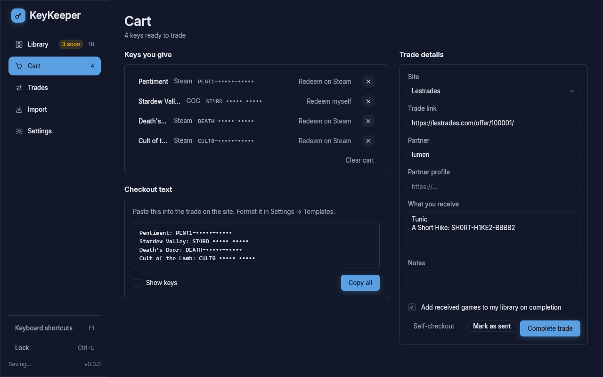

# KeyKeeper

An encrypted, spreadsheet-style desktop app for managing game keys (Steam and others) and trading them on sites like [lestrades.com](https://lestrades.com), with reputation posts for [steamtrades.com](https://www.steamtrades.com).

Built in Rust with the [RUNE](https://github.com/anomalyco/rune) GPU UI framework. Windows first, macOS next.

> **Status:** early and pre-release (RUNE itself is pre-release). Back up your vault.


## Features

- **Encrypted vault.** All keys, trades and settings live in one file encrypted with your password. Argon2id derives the key, and the data is encrypted with XChaCha20-Poly1305. Saves are atomic, and the app keeps rotating encrypted backups. There is no password recovery.
- **Library.** A fast, sortable table with search across names, bundles, notes, tags and keys. Keys stay masked until you reveal or copy them. Undo/redo covers every change, and toasts for most changes have an **Undo** button.
  - **At a glance:** under the title, how many keys you still hold, how many are in the cart, what they're worth at today's cheapest prices, and how many redemption deadlines are near or past. Each figure is a shortcut to its filter, and the sidebar shows "N soon" when deadlines are close. Near deadlines read "in 12 days" / "6 days ago".
  - **Filters:** status, hide traded & redeemed, deadline within 30 days, no Steam id, **Spares I own** (keys still in hand for games you already own on Steam) and **Duplicates** (games you have more than one key for).
  - **Game details on hover:** rest the pointer on a game's name to see its artwork, developer, release year, tags, description, review score, Steam Deck status, ownership, best price and all-time low, deadline and bundle. You can turn it off or change the delay in Settings › Library.
  - **Right-click menu** on any row (or the Menu key): edit, copy the key, cart, redeem, set status, open on Steam / gg.deals / IsThereAnyDeal, show the key's trade or open its trade link, **Refresh prices & ratings** for just the selected games, delete. With several rows selected it acts on all of them.
  - **Bulk edit:** select several keys and choose **Edit…** to set status, platform, bundle, source or deadline, or add and remove tags, for all of them in one undo step.
  - **View menu:** table or **grid with artwork**, comfortable or compact rows, **group by bundle or source** (foldable; "Humble" and "humble" are one group), and which columns to show (also by right-clicking a column header), including an optional sortable **Source** column. Column widths, order, sort and view are remembered.
  - **Bundle and source suggestions:** while you type in the key editor, the bundles and sources you already use appear as chips to pick, and a value that differs only in case is saved with the spelling your library already uses.
- **Statuses.** Available, Reserved (in the cart), Traded, Redeemed, Gifted, Unknown.
- **Import.** Reads CSV/TSV exports, Excel or Sheets pastes, and plain lists like `Game: XXXXX-XXXXX-XXXXX`. Columns are matched automatically and you can remap them. Dates follow a day-first or month-first setting. A preview marks each row as new, duplicate or error before anything is added.
- **Export.** CSV (re-imports cleanly), JSON, or an encrypted backup copy.
- **Trading.**
  - Add keys to a cart (a floating cart button shows the count) and copy the checkout text (`{name}: {key}` by default).
  - Record the partner, trade link and what you receive. Mark the trade as sent, then complete it: your keys become *Traded*, and received games can be added to your library.
  - Set the date a trade happened (typed or from a calendar), for example for trades imported from a spreadsheet. Its traded keys get the same date.
  - Generate a steamtrades reputation post.
  - **Copy have list** copies the names of the tradable keys in view (never the keys), one line per game with copies merged ("Tunic x2"), for a trading site's "have" list.
  - All three texts come from templates you can edit in Settings › Templates.
- **Steam.**
  - Match games to Steam app ids, then fetch review scores (the header's **Steam** menu). Keys with the same game share one search. Games without an exact match open a **review** where you pick from Steam's closest results or search again with other words; a library-wide match skips them for two weeks unless you select them.
  - Requests are paced per site (Steam's store search more slowly), wait out and retry rate limits, and slow down after one. A batch that stops early keeps what it already fetched; the rest is fetched next time. The status bar shows progress and what's happening, for example the pause gg.deals needs between batches of 100 games.
  - Check your public wishlist, and your library if you add a Web API key.
  - Store details and header art for the hover card, grid and editor come from Steam's store. Artwork is cached **encrypted** next to your vault (`<vault>.cache/`, file names don't reveal which games), and you can turn fetching off or clear the cache in Settings › Library.
  - Game names link to their Steam page, and the key editor has link buttons for Steam, gg.deals and IsThereAnyDeal.
  - **Redeem on Steam** opens Steam's activation page with the key filled in and marks the key Redeemed with today's date. Non-Steam keys get **Mark redeemed by me**. In the cart, each key has a Redeem button, and **Self-checkout** marks every cart key redeemed.
- **Prices.** With an IsThereAnyDeal and/or gg.deals API key and your country (Settings › Prices), the library's Deals column shows each game's cheapest current store price, marked **LOW** when it matches the all-time low. Hover it to see every store, the all-time low and the keyshop price; click it to open the deal.
- **Diagnostics.** Settings › Diagnostics shows recent activity (requests, rate limits, errors) and can export the log or open its folder (`%APPDATA%\KeyKeeper\data\logs` on Windows). Keys and API keys are never logged.
- **Security.** Copied keys are excluded from clipboard history and cleared after a delay. The app locks itself when idle and saves before locking.
- **Themes.** Midnight (default), Amethyst, Forest, Opencode, Graphite, Light, System. The window opens at the size you left it.

| Game details on hover | Grid with artwork | Row menu |
|---|---|---|
|  |  |  |

| Key editor | Cart & checkout | Trades & reputation |
|---|---|---|
|  |  |  |

Screenshots use demo data. Without artwork (offline, or fetching turned off) each game gets a coloured card with its initials.

## Install

Download the installer for your system from the [latest release](https://github.com/Mx772/key-keeper/releases/latest):

| System | File |
|---|---|
| Windows 10/11 (x64) | `KeyKeeper_<version>_x64-setup.exe`. Installs for the current user, no admin needed. |
| macOS 13+ (Apple silicon) | `KeyKeeper_<version>_aarch64.dmg`. Open it and drag KeyKeeper to Applications. |
| macOS 13+ (Intel) | `KeyKeeper_<version>_x64.dmg` |

`SHA256SUMS.txt` in the release lists each file's checksum.

> **The builds are not code-signed yet,** so your OS will warn you the first time:
>
> - **Windows SmartScreen** says "Windows protected your PC". Click **More info**, then **Run anyway**.
> - **macOS Gatekeeper** says the app can't be opened or is from an unidentified developer. Try to open it once, then go to **System Settings › Privacy & Security** and click **Open Anyway**. If macOS says the app "is damaged", run `xattr -dr com.apple.quarantine /Applications/KeyKeeper.app` in Terminal.

Your vault is stored outside the app (`%APPDATA%\KeyKeeper\data` on Windows, `~/Library/Application Support/KeyKeeper` on macOS), and uninstalling does not delete it. You can pick another location on the lock screen. The encrypted artwork cache sits next to the vault in `vault.kkvault.cache`; delete it whenever you like (or use Settings › Library › Clear).

## Updates

KeyKeeper checks for a newer version about 5 seconds after it starts, then once a day while it keeps running. The check never blocks the app, and a failed automatic check stays silent.

- **What is sent:** one HTTPS GET for `https://github.com/Mx772/key-keeper/releases/latest/download/latest.json`, a small file listing the newest published version, its release notes and download links. Nothing about you or your vault is sent. GitHub sees the request like any download.
- **Nothing installs without you.** A newer version shows a banner with **What's new**, **Update**, **Later** (hide it until the next launch) and **Skip this version**. Only versions newer than yours are offered; drafts and prereleases never are.
- **Update** first saves your vault, then downloads the installer and checks its signature against KeyKeeper's release key, which is built into the app. A download that doesn't match is refused. On Windows the installer then runs and restarts KeyKeeper. On macOS the app bundle is replaced and KeyKeeper restarts.
- **Before a new version saves your vault for the first time,** it keeps a copy of the file as the previous version left it, next to the vault: `vault.kkvault.pre-<version>`. It opens with the same password, also in the older version. Delete these copies whenever you like.
- **Turn it off** in **Settings › Updates** by unchecking "Check for updates automatically". **Check now** still works. The setting is stored in `config.toml`.

## Keyboard shortcuts

On macOS, use ⌘ wherever this list says Ctrl. Press **F1** (or **Ctrl+/**) in the app to see this list.

| Shortcut | Action |
|---|---|
| Ctrl+F | Search the library |
| Ctrl+N | New key |
| Ctrl+I | Import keys |
| Ctrl+S | Save the open key |
| Ctrl+Z | Undo |
| Ctrl+Y or Ctrl+Shift+Z | Redo |
| Ctrl+Shift+C | Copy the selected keys as "Name: Key" |
| Delete | Delete the selected keys (asks first) |
| ↑ / ↓ | Move through the library (or type a game's name to jump to it) |
| Enter or F2 | Edit the selected key |
| Ctrl+C | Copy the selected key |
| Ctrl+B | Add the selected keys to the cart, or take them out |
| Menu or Shift+F10 | Actions menu for the selected keys (or right-click a row) |
| Ctrl+L | Lock the vault |
| Esc | Close a dialog, menu or the editor |
| F1 or Ctrl+/ | Show keyboard shortcuts |

## Building

Requirements:

- Rust via [rustup](https://rustup.rs). The toolchain is pinned in `rust-toolchain.toml` and installs automatically.
- Windows: the Visual Studio C++ Build Tools (MSVC).
- macOS: the Xcode command line tools.

```sh
cargo run -p keykeeper-app            # run the app
cargo test --workspace                # all tests (headless, no network)
cargo test -p keykeeper-steam -- --ignored   # live Steam endpoint check
```

Every screen can be rendered headless with throwaway demo data, which never touches your real vault:

```sh
cargo run -p keykeeper-app -- --snap library.png --scene library --size 1280x800
# scenes: lock create library detail new-key import import-start cart trades settings templates shortcuts update update-notes update-lock empty light
```

### Installers

[cargo-packager](https://github.com/crabnebula-dev/cargo-packager) builds the installers (an NSIS `setup.exe` on Windows, `KeyKeeper.app` and a `.dmg` on macOS) into `target/dist`. Its settings are in `crates/keykeeper-app/Cargo.toml`.

```sh
cargo install cargo-packager --locked
cargo build --release -p keykeeper-app
cargo packager --release
```

### Releasing

Pushing a `v*` tag runs `.github/workflows/release.yml`. It fails early unless the tag matches the version in `Cargo.toml`, the signing secrets are set, and a vault fixture exists for that version. It then builds on Windows and macOS, runs each release binary's internal `--self-test` (a headless smoke test that creates, reopens and renders a throwaway vault), signs the updater artifacts, and attaches the installers, signatures, `SHA256SUMS.txt` and `latest.json` to a **draft** GitHub release.

1. Bump `version` in the root `Cargo.toml`.
2. Add the vault compatibility fixture for the new version and commit it:
   ```sh
   cargo test -p keykeeper-core --test compat -- --ignored generate_fixture
   ```
   This writes `crates/keykeeper-core/tests/fixtures/vaults/v<version>.kkvault`, with fake keys only. Every later build must keep opening every fixture in that directory (`cargo test` checks it).
3. Tag and push: `git tag v<version> && git push origin v<version>`.
4. Review the draft release. Publish it when ready. Until then the app's update check can't see it, because `releases/latest` never points at drafts or prereleases.

`latest.json` takes its notes from the generated release notes. If you edit the notes in the draft, the update dialog still shows the generated ones. To change them, edit `notes` in `latest.json` and re-upload it with `gh release upload v<version> latest.json --clobber`.

**Updater signing.** The workflow needs two repository secrets: `UPDATER_PRIVATE_KEY` (the contents of the minisign private key file made by `cargo packager signer generate`) and `UPDATER_PRIVATE_KEY_PASSWORD`. If either is missing, the workflow fails instead of shipping an unsigned manifest. The matching public key is `crates/keykeeper-app/keys/updater.pub`, built into the app. Keep the private key outside the repository. Losing it means existing installs can't verify future updates, and users would have to reinstall by hand.

To check a locally signed artifact against the built-in key:

```sh
KEYKEEPER_VERIFY="$PWD/target/dist/<file>" cargo test -p keykeeper-app verify_artifact -- --ignored
```

The app icon's source is `crates/keykeeper-app/assets/icon.svg`. After editing it, run `python crates/keykeeper-app/assets/make-icons.py` to regenerate the PNG, ICO and ICNS files. This needs the `resvg` CLI and Pillow.

## Steam Web API key (optional)

Only needed to check which games you already own. Create one at <https://steamcommunity.com/dev/apikey>. The form asks for a domain name; any value (e.g. `localhost`) works. The key is stored inside your encrypted vault.

## Project layout

| Crate | What it does |
|---|---|
| `crates/keykeeper-core` | Model, encrypted vault, import/export, search, trades, templates. No GUI and no network. |
| `crates/keykeeper-steam` | Steam store and Web API clients behind a trait (tests use recorded responses). |
| `crates/keykeeper-app` | The RUNE desktop app. `src/tests.rs` drives the real UI headlessly. |

## License

[MIT](LICENSE)
