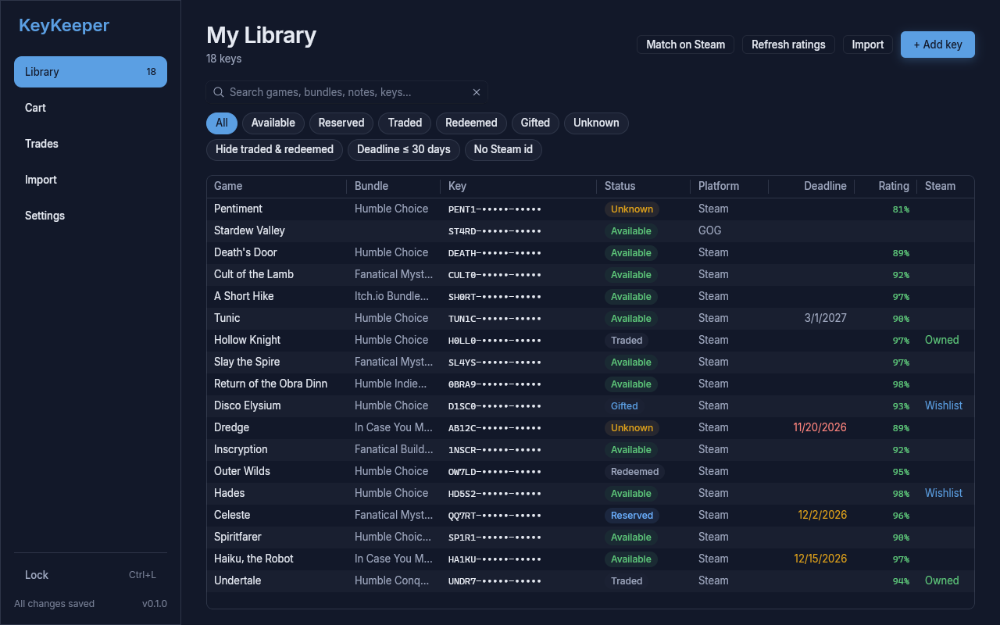
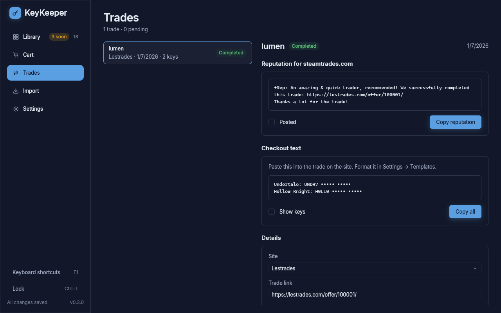

# KeyKeeper

An encrypted, spreadsheet-style desktop app for managing game keys (Steam and others) and trading them on sites like [lestrades.com](https://lestrades.com), with reputation posts for [steamtrades.com](https://www.steamtrades.com).

Built in Rust with the [RUNE](https://github.com/anomalyco/rune) GPU UI framework. Windows first, macOS next.

> **Status:** early and pre-release (RUNE itself is pre-release). Back up your vault.



## Features

- **Encrypted vault.** All keys, trades and settings live in one file encrypted with your password. Argon2id derives the key, and the data is encrypted with XChaCha20-Poly1305. Saves are atomic, and the app keeps rotating encrypted backups. There is no password recovery.
- **Library.** A fast, sortable table with search across names, bundles, notes, tags and keys. You can filter by status, upcoming redemption deadline, or missing Steam id. Keys stay masked until you reveal or copy them. Undo/redo covers every change.
- **Statuses.** Available, Reserved (in the cart), Traded, Redeemed, Gifted, Unknown.
- **Import.** Reads CSV/TSV exports, Excel or Sheets pastes, and plain lists like `Game: XXXXX-XXXXX-XXXXX`. Columns are matched automatically and you can remap them. Dates follow a day-first or month-first setting. A preview marks each row as new, duplicate or error before anything is added.
- **Export.** CSV (re-imports cleanly), JSON, or an encrypted backup copy.
- **Trading.**
  - Add keys to a cart and copy the checkout text (`{name}: {key}` by default).
  - Record the partner, trade link and what you receive. Mark the trade as sent, then complete it: your keys become *Traded*, and received games can be added to your library.
  - Generate a steamtrades reputation post. Both texts come from templates you can edit.
- **Steam.**
  - Match games to Steam app ids, then fetch review scores.
  - Check your public wishlist, and your library if you add a Web API key.
  - Links to Steam, gg.deals and IsThereAnyDeal.
- **Security.** Copied keys are excluded from clipboard history and cleared after a delay. The app locks itself when idle and saves before locking.
- **Themes.** Midnight (default), Amethyst, Forest, Opencode, Graphite, Light, System.

| Key editor | Cart & checkout | Trades & reputation |
|---|---|---|
|  |  |  |

## Install

Download the installer for your system from the [latest release](https://github.com/Mx772/key-keeper/releases/latest):

| System | File |
|---|---|
| Windows 10/11 (x64) | `KeyKeeper_<version>_x64-setup.exe`. Installs for the current user, no admin needed. |
| macOS 13+ (Apple silicon) | `KeyKeeper_<version>_aarch64.dmg`. Open it and drag KeyKeeper to Applications. |
| macOS 13+ (Intel) | `KeyKeeper_<version>_x64.dmg` |

`SHA256SUMS.txt` in the release lists each file's checksum.

> **The builds are not code-signed yet,** so your OS will warn you the first time:
>
> - **Windows SmartScreen** says "Windows protected your PC". Click **More info**, then **Run anyway**.
> - **macOS Gatekeeper** says the app can't be opened or is from an unidentified developer. Try to open it once, then go to **System Settings › Privacy & Security** and click **Open Anyway**. If macOS says the app "is damaged", run `xattr -dr com.apple.quarantine /Applications/KeyKeeper.app` in Terminal.

Your vault is stored outside the app (`%APPDATA%\KeyKeeper\data` on Windows, `~/Library/Application Support/KeyKeeper` on macOS), and uninstalling does not delete it. You can pick another location on the lock screen.

## Keyboard shortcuts

On macOS, use ⌘ wherever this list says Ctrl. Press **F1** (or **Ctrl+/**) in the app to see this list.

| Shortcut | Action |
|---|---|
| Ctrl+F | Search the library |
| Ctrl+N | New key |
| Ctrl+I | Import keys |
| Ctrl+S | Save the open key |
| Ctrl+Z | Undo |
| Ctrl+Y or Ctrl+Shift+Z | Redo |
| Ctrl+Shift+C | Copy the selected keys as "Name: Key" |
| Delete | Delete the selected keys (asks first) |
| Ctrl+L | Lock the vault |
| Esc | Close a dialog or the editor |
| F1 or Ctrl+/ | Show keyboard shortcuts |

## Building

Requirements:

- Rust via [rustup](https://rustup.rs). The toolchain is pinned in `rust-toolchain.toml` and installs automatically.
- Windows: the Visual Studio C++ Build Tools (MSVC).
- macOS: the Xcode command line tools.

```sh
cargo run -p keykeeper-app            # run the app
cargo test --workspace                # all tests (headless, no network)
cargo test -p keykeeper-steam -- --ignored   # live Steam endpoint check
```

Every screen can be rendered headless with throwaway demo data, which never touches your real vault:

```sh
cargo run -p keykeeper-app -- --snap library.png --scene library --size 1280x800
# scenes: lock create library detail new-key import import-start cart trades settings templates shortcuts empty light
```

### Installers

[cargo-packager](https://github.com/crabnebula-dev/cargo-packager) builds the installers (an NSIS `setup.exe` on Windows, `KeyKeeper.app` and a `.dmg` on macOS) into `target/dist`. Its settings are in `crates/keykeeper-app/Cargo.toml`.

```sh
cargo install cargo-packager --locked
cargo build --release -p keykeeper-app
cargo packager --release
```

Pushing a `v*` tag runs `.github/workflows/release.yml`, which builds the installers on Windows and macOS and attaches them to a **draft** GitHub release for review. The tag must match the version in `Cargo.toml`.

The app icon's source is `crates/keykeeper-app/assets/icon.svg`. After editing it, run `python crates/keykeeper-app/assets/make-icons.py` to regenerate the PNG, ICO and ICNS files. This needs the `resvg` CLI and Pillow.

## Steam Web API key (optional)

Only needed to check which games you already own. Create one at <https://steamcommunity.com/dev/apikey>. The form asks for a domain name; any value (e.g. `localhost`) works. The key is stored inside your encrypted vault.

## Project layout

| Crate | What it does |
|---|---|
| `crates/keykeeper-core` | Model, encrypted vault, import/export, search, trades, templates. No GUI and no network. |
| `crates/keykeeper-steam` | Steam store and Web API clients behind a trait (tests use recorded responses). |
| `crates/keykeeper-app` | The RUNE desktop app. `src/tests.rs` drives the real UI headlessly. |

## License

[MIT](LICENSE)
